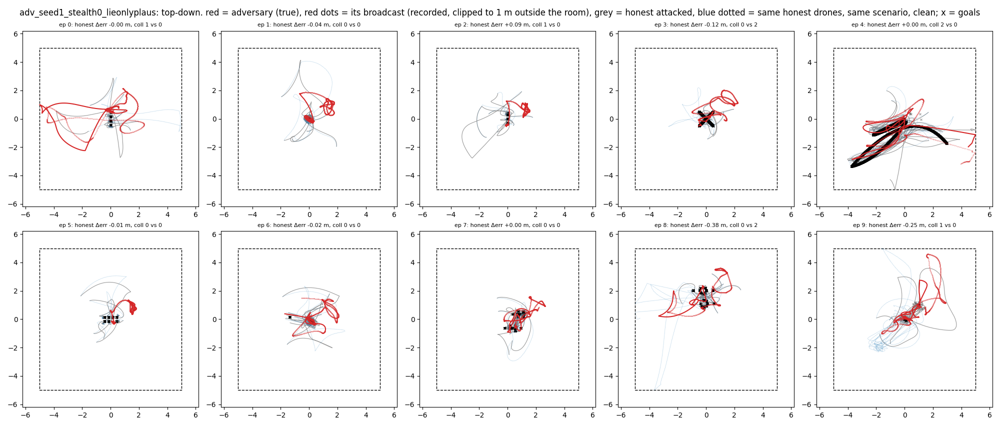
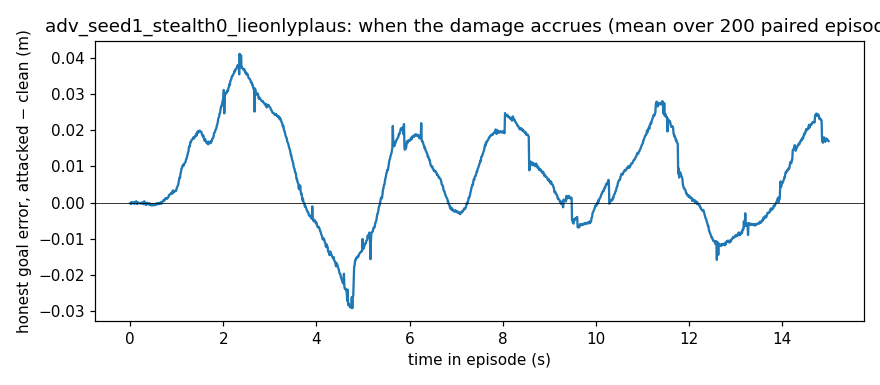

# Behaviour -- `adv_seed1_stealth0_lieonlyplaus` (spec item 7)

200 paired episodes (own-seed confirmatory vs clean, seed 1); figures show the first 10. Broadcasts recorded. These are the numbers the plain-language description must agree with.

| observation | attacked | clean | paired p |
|---|---|---|---|
| honest goal error, episode mean (m) | 0.726 | 0.719 | 0.4947 |
| adversary's OWN goal error change vs same drone clean (m) | +0.093 | 0 | 0.0000 |
| team collisions per episode | 0.61 | 0.34 | 0.0000 |
| honest–honest minimum separation (m) | 0.134 | 0.140 | 0.0695 |
| collision steps whose closest pair INCLUDES the adversary's slot | 0.31 | 0.10 | 0.0000 |
| collision steps between two honest drones | 0.30 | 0.23 | 0.1359 |
| adversary-slot ↔ nearest honest, minimum separation (m) | 0.139 | 0.175 | 0.0000 |
| honest speed (m/s) | 1.024 | 1.019 | 0.5695 |
| honest jitter, mean ‖Δv‖ per step (m/s) | 0.0243 | 0.0238 | 0.1718 |

**When.** Share of the honest goal-error increase accrued in the first / middle / last third of the episode: +0.38 / +0.34 / +0.27.
**Where.** Spearman correlation of an honest drone's goal-error increase with its mean distance to the adversary's slot in the same scenario, clean: ρ = -0.093 (p = 0.000461). Mean increase for the 2 honest drones nearest that slot +0.055 m vs the 2 farthest -0.075 m.
**The phantom** (first 10 episodes). Distance from honest drones to the adversary's broadcast position: median 1.98 m, vs to its true position 0.62 m.

