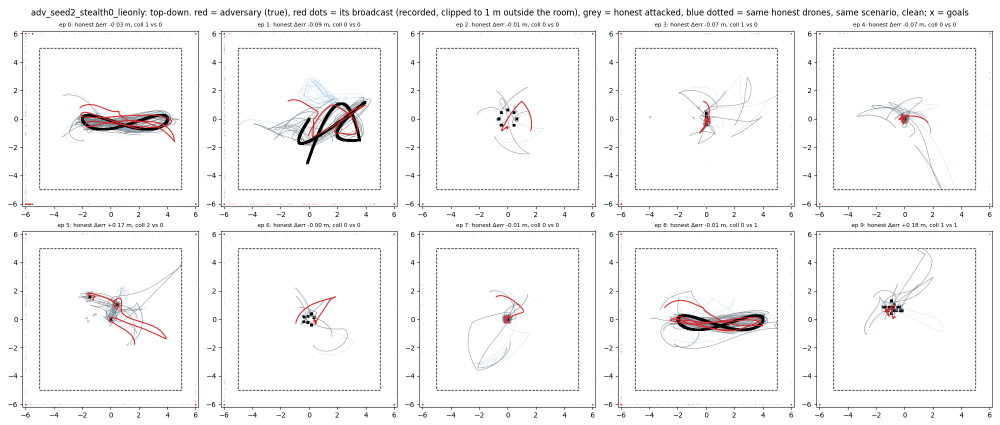
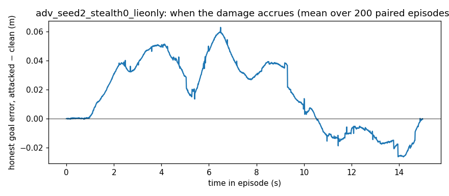

# Behaviour -- `adv_seed2_stealth0_lieonly` (spec item 7)

200 paired episodes (own-seed confirmatory vs clean, seed 2); figures show the first 10. Broadcasts recorded. These are the numbers the plain-language description must agree with.

| observation | attacked | clean | paired p |
|---|---|---|---|
| honest goal error, episode mean (m) | 0.726 | 0.709 | 0.1285 |
| adversary's OWN goal error change vs same drone clean (m) | +0.103 | 0 | 0.0010 |
| team collisions per episode | 0.62 | 0.36 | 0.0007 |
| honest–honest minimum separation (m) | 0.133 | 0.136 | 0.4189 |
| collision steps whose closest pair INCLUDES the adversary's slot | 0.33 | 0.10 | 0.0001 |
| collision steps between two honest drones | 0.29 | 0.26 | 0.5330 |
| adversary-slot ↔ nearest honest, minimum separation (m) | 0.132 | 0.176 | 0.0000 |
| honest speed (m/s) | 0.959 | 0.934 | 0.0025 |
| honest jitter, mean ‖Δv‖ per step (m/s) | 0.0238 | 0.0226 | 0.0013 |

**When.** Share of the honest goal-error increase accrued in the first / middle / last third of the episode: +0.38 / +0.47 / -0.15.
**Where.** Spearman correlation of an honest drone's goal-error increase with its mean distance to the adversary's slot in the same scenario, clean: ρ = -0.049 (p = 0.0657). Mean increase for the 2 honest drones nearest that slot +0.056 m vs the 2 farthest -0.075 m.
**The phantom** (first 10 episodes). Distance from honest drones to the adversary's broadcast position: median 17.34 m, vs to its true position 0.59 m.

