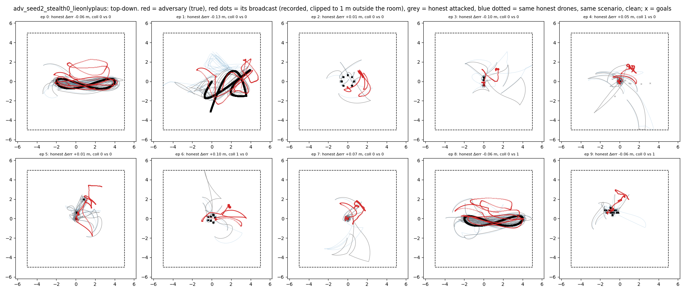
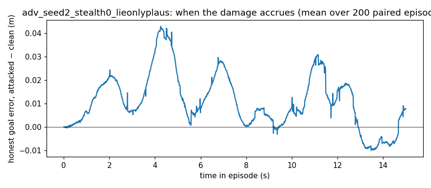

# Behaviour -- `adv_seed2_stealth0_lieonlyplaus` (spec item 7)

200 paired episodes (own-seed confirmatory vs clean, seed 2); figures show the first 10. Broadcasts recorded. These are the numbers the plain-language description must agree with.

| observation | attacked | clean | paired p |
|---|---|---|---|
| honest goal error, episode mean (m) | 0.720 | 0.709 | 0.2952 |
| adversary's OWN goal error change vs same drone clean (m) | +0.088 | 0 | 0.0033 |
| team collisions per episode | 0.62 | 0.36 | 0.0015 |
| honest–honest minimum separation (m) | 0.133 | 0.136 | 0.4851 |
| collision steps whose closest pair INCLUDES the adversary's slot | 0.28 | 0.10 | 0.0002 |
| collision steps between two honest drones | 0.34 | 0.26 | 0.1800 |
| adversary-slot ↔ nearest honest, minimum separation (m) | 0.138 | 0.176 | 0.0000 |
| honest speed (m/s) | 0.957 | 0.934 | 0.0098 |
| honest jitter, mean ‖Δv‖ per step (m/s) | 0.0235 | 0.0226 | 0.0192 |

**When.** Share of the honest goal-error increase accrued in the first / middle / last third of the episode: +0.50 / +0.29 / +0.21.
**Where.** Spearman correlation of an honest drone's goal-error increase with its mean distance to the adversary's slot in the same scenario, clean: ρ = -0.117 (p = 1.16e-05). Mean increase for the 2 honest drones nearest that slot +0.079 m vs the 2 farthest -0.103 m.
**The phantom** (first 10 episodes). Distance from honest drones to the adversary's broadcast position: median 1.97 m, vs to its true position 0.58 m.

