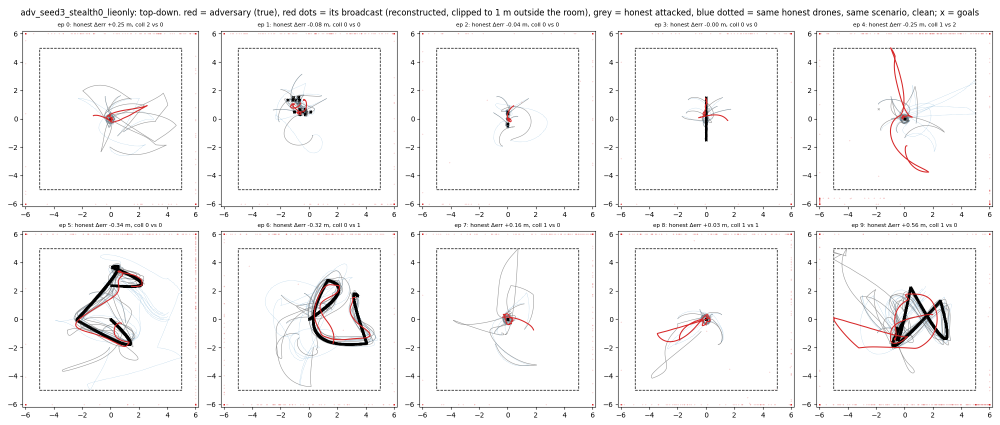
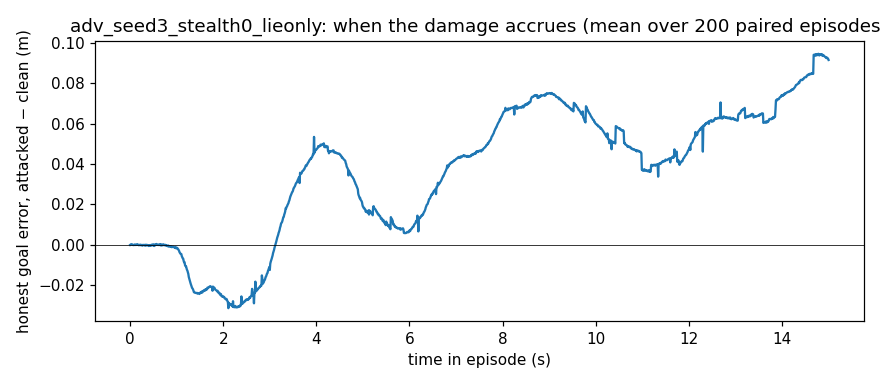

# Behaviour -- `adv_seed3_stealth0_lieonly` (spec item 7)

200 paired episodes (own-seed confirmatory vs clean, seed 3); figures show the first 10. Broadcasts reconstructed. These are the numbers the plain-language description must agree with.

| observation | attacked | clean | paired p |
|---|---|---|---|
| honest goal error, episode mean (m) | 0.777 | 0.741 | 0.0042 |
| adversary's OWN goal error change vs same drone clean (m) | +0.182 | 0 | 0.0000 |
| team collisions per episode | 0.91 | 0.42 | 0.0000 |
| honest–honest minimum separation (m) | 0.135 | 0.133 | 0.6193 |
| collision steps whose closest pair INCLUDES the adversary's slot | 0.54 | 0.11 | 0.0000 |
| collision steps between two honest drones | 0.36 | 0.32 | 0.4277 |
| adversary-slot ↔ nearest honest, minimum separation (m) | 0.129 | 0.174 | 0.0000 |
| honest speed (m/s) | 1.022 | 0.991 | 0.0023 |
| honest jitter, mean ‖Δv‖ per step (m/s) | 0.0242 | 0.0226 | 0.0002 |

**When.** Share of the honest goal-error increase accrued in the first / middle / last third of the episode: +0.04 / +0.41 / +0.55.
**Where.** Spearman correlation of an honest drone's goal-error increase with its mean distance to the adversary's slot in the same scenario, clean: ρ = -0.162 (p = 9.78e-10). Mean increase for the 2 honest drones nearest that slot +0.067 m vs the 2 farthest -0.061 m.
**The phantom** (first 10 episodes). Distance from honest drones to the adversary's broadcast position: median 17.26 m, vs to its true position 0.65 m.

