# Tier 3 reward components over training (spec item 2)

Binned means over env steps (40 bins). `first` / `last` are the first and last 10 % of training. `r_team` is an episode sum: read it with `len/len` (training_curve.py).

| adversary | component | first 10 % | last 10 % | change |
|---|---|---|---|---|
| `adv_seed1_stealth0` | `adv/r_team` | -18.669 | -21.171 | -2.502 |
| `adv_seed1_stealth0` | `adv/r_crash` | -16.243 | -10.006 | +6.237 |
| `adv_seed1_stealth0` | `adv/r_alive` | +0.731 | +0.633 | -0.098 |
| `adv_seed1_stealth0` | `adv/r_stealth` | +0.000 | +0.000 | +0.000 |
| `adv_seed1_stealth0` | `adv/survived` | +1.000 | +1.000 | +0.000 |
| `adv_seed1_stealth0` | `len/len` | +1499.812 | +1501.000 | +1.188 |
| `adv_seed1_stealth0_f250` | `adv/r_team` | -22.582 | -22.244 | +0.338 |
| `adv_seed1_stealth0_f250` | `adv/r_crash` | -27.043 | -10.731 | +16.311 |
| `adv_seed1_stealth0_f250` | `adv/r_alive` | +4.003 | +3.310 | -0.693 |
| `adv_seed1_stealth0_f250` | `adv/r_stealth` | +0.000 | +0.000 | +0.000 |
| `adv_seed1_stealth0_f250` | `adv/survived` | +0.002 | +0.000 | -0.002 |
| `adv_seed1_stealth0_f250` | `len/len` | +1499.771 | +1501.000 | +1.229 |
| `adv_seed1_stealth0_lie` | `adv/r_team` | -19.482 | -21.688 | -2.206 |
| `adv_seed1_stealth0_lie` | `adv/r_crash` | -11.223 | -10.004 | +1.219 |
| `adv_seed1_stealth0_lie` | `adv/r_alive` | +0.683 | +0.629 | -0.053 |
| `adv_seed1_stealth0_lie` | `adv/r_stealth` | +0.000 | +0.000 | +0.000 |
| `adv_seed1_stealth0_lie` | `adv/survived` | +0.000 | +0.000 | -0.000 |
| `adv_seed1_stealth0_lie` | `len/len` | +1499.828 | +1501.000 | +1.172 |
| `adv_seed1_stealth0_lie` | `adv/lie_magnitude_m` | +15.372 | +16.608 | +1.236 |
| `adv_seed1_stealth0_lieonly` | `adv/r_team` | -12.810 | -13.878 | -1.068 |
| `adv_seed1_stealth0_lieonly` | `adv/r_crash` | -5.562 | -5.006 | +0.556 |
| `adv_seed1_stealth0_lieonly` | `adv/r_alive` | +10.724 | +10.293 | -0.431 |
| `adv_seed1_stealth0_lieonly` | `adv/r_stealth` | +0.000 | +0.000 | +0.000 |
| `adv_seed1_stealth0_lieonly` | `adv/survived` | +0.998 | +0.998 | +0.000 |
| `adv_seed1_stealth0_lieonly` | `len/len` | +1074.648 | +1032.145 | -42.503 |
| `adv_seed1_stealth0_lieonly` | `adv/lie_magnitude_m` | +13.733 | +15.921 | +2.188 |
| `adv_seed1_stealth0_lieonlyplaus` | `adv/r_team` | -15.659 | -15.351 | +0.308 |
| `adv_seed1_stealth0_lieonlyplaus` | `adv/r_crash` | -5.138 | -4.931 | +0.207 |
| `adv_seed1_stealth0_lieonlyplaus` | `adv/r_alive` | +10.652 | +10.298 | -0.353 |
| `adv_seed1_stealth0_lieonlyplaus` | `adv/r_stealth` | +0.000 | +0.000 | +0.000 |
| `adv_seed1_stealth0_lieonlyplaus` | `adv/survived` | +0.998 | +0.998 | -0.000 |
| `adv_seed1_stealth0_lieonlyplaus` | `len/len` | +1067.060 | +1032.715 | -34.345 |
| `adv_seed1_stealth0_lieonlyplaus` | `adv/lie_magnitude_m` | +1.571 | +1.517 | -0.054 |
| `adv_seed1_stealth0_lieonlyplaus` | `adv/lie_wall_limited_frac` | +0.008 | +0.010 | +0.003 |
| `adv_seed1_stealth5` | `adv/r_team` | -18.567 | -21.196 | -2.629 |
| `adv_seed1_stealth5` | `adv/r_crash` | -304.624 | -244.793 | +59.831 |
| `adv_seed1_stealth5` | `adv/r_alive` | +9.517 | +5.240 | -4.277 |
| `adv_seed1_stealth5` | `adv/r_stealth` | -356939.221 | -528393.199 | -171453.978 |
| `adv_seed1_stealth5` | `adv/survived` | +0.999 | +0.956 | -0.043 |
| `adv_seed1_stealth5` | `len/len` | +1495.824 | +1457.257 | -38.567 |
| `adv_seed1_stealth5_f250` | `adv/r_team` | -19.701 | -20.252 | -0.551 |
| `adv_seed1_stealth5_f250` | `adv/r_crash` | -309.320 | -329.199 | -19.879 |
| `adv_seed1_stealth5_f250` | `adv/r_alive` | +40.628 | +43.081 | +2.453 |
| `adv_seed1_stealth5_f250` | `adv/r_stealth` | -12231.635 | -10361.632 | +1870.003 |
| `adv_seed1_stealth5_f250` | `adv/survived` | +0.156 | +0.250 | +0.094 |
| `adv_seed1_stealth5_f250` | `len/len` | +1499.770 | +1323.009 | -176.762 |
| `adv_seed2_stealth0_lieonly` | `adv/r_team` | -13.600 | -13.408 | +0.191 |
| `adv_seed2_stealth0_lieonly` | `adv/r_crash` | -6.505 | -5.995 | +0.510 |
| `adv_seed2_stealth0_lieonly` | `adv/r_alive` | +10.769 | +10.246 | -0.523 |
| `adv_seed2_stealth0_lieonly` | `adv/r_stealth` | +0.000 | +0.000 | +0.000 |
| `adv_seed2_stealth0_lieonly` | `adv/survived` | +0.996 | +0.997 | +0.000 |
| `adv_seed2_stealth0_lieonly` | `len/len` | +1080.276 | +1028.882 | -51.394 |
| `adv_seed2_stealth0_lieonly` | `adv/lie_magnitude_m` | +15.328 | +16.817 | +1.489 |
| `adv_seed2_stealth0_lieonlyplaus` | `adv/r_team` | -13.756 | -13.663 | +0.092 |
| `adv_seed2_stealth0_lieonlyplaus` | `adv/r_crash` | -6.372 | -5.819 | +0.553 |
| `adv_seed2_stealth0_lieonlyplaus` | `adv/r_alive` | +10.769 | +10.249 | -0.520 |
| `adv_seed2_stealth0_lieonlyplaus` | `adv/r_stealth` | +0.000 | +0.000 | +0.000 |
| `adv_seed2_stealth0_lieonlyplaus` | `adv/survived` | +0.997 | +0.997 | -0.000 |
| `adv_seed2_stealth0_lieonlyplaus` | `len/len` | +1080.249 | +1029.249 | -51.000 |
| `adv_seed2_stealth0_lieonlyplaus` | `adv/lie_magnitude_m` | +1.626 | +1.589 | -0.037 |
| `adv_seed2_stealth0_lieonlyplaus` | `adv/lie_wall_limited_frac` | +0.006 | +0.008 | +0.002 |
| `adv_seed3_stealth0_lieonly` | `adv/r_team` | -9.095 | -8.986 | +0.108 |
| `adv_seed3_stealth0_lieonly` | `adv/r_crash` | -8.313 | -8.288 | +0.025 |
| `adv_seed3_stealth0_lieonly` | `adv/r_alive` | +10.604 | +10.202 | -0.402 |
| `adv_seed3_stealth0_lieonly` | `adv/r_stealth` | +0.000 | +0.000 | +0.000 |
| `adv_seed3_stealth0_lieonly` | `adv/survived` | +0.994 | +0.995 | +0.001 |
| `adv_seed3_stealth0_lieonly` | `len/len` | +1065.256 | +1026.076 | -39.180 |
| `adv_seed3_stealth0_lieonly` | `adv/lie_magnitude_m` | +13.887 | +16.767 | +2.880 |
| `adv_seed3_stealth0_lieonlyego` | `adv/r_team` | -9.205 | -7.291 | +1.914 |
| `adv_seed3_stealth0_lieonlyego` | `adv/r_crash` | -8.265 | -8.344 | -0.079 |
| `adv_seed3_stealth0_lieonlyego` | `adv/r_alive` | +10.629 | +10.169 | -0.460 |
| `adv_seed3_stealth0_lieonlyego` | `adv/r_stealth` | +0.000 | +0.000 | +0.000 |
| `adv_seed3_stealth0_lieonlyego` | `adv/survived` | +0.994 | +0.995 | +0.000 |
| `adv_seed3_stealth0_lieonlyego` | `len/len` | +1067.706 | +1022.767 | -44.938 |
| `adv_seed3_stealth0_lieonlyego` | `adv/lie_magnitude_m` | +13.612 | +16.199 | +2.588 |
| `adv_seed3_stealth0_lieonlyplaus` | `adv/r_team` | -9.472 | -7.873 | +1.599 |
| `adv_seed3_stealth0_lieonlyplaus` | `adv/r_crash` | -8.510 | -8.152 | +0.358 |
| `adv_seed3_stealth0_lieonlyplaus` | `adv/r_alive` | +10.719 | +10.152 | -0.567 |
| `adv_seed3_stealth0_lieonlyplaus` | `adv/r_stealth` | +0.000 | +0.000 | +0.000 |
| `adv_seed3_stealth0_lieonlyplaus` | `adv/survived` | +0.995 | +0.994 | -0.001 |
| `adv_seed3_stealth0_lieonlyplaus` | `len/len` | +1076.721 | +1021.010 | -55.711 |
| `adv_seed3_stealth0_lieonlyplaus` | `adv/lie_magnitude_m` | +1.596 | +1.520 | -0.076 |
| `adv_seed3_stealth0_lieonlyplaus` | `adv/lie_wall_limited_frac` | +0.020 | +0.011 | -0.010 |

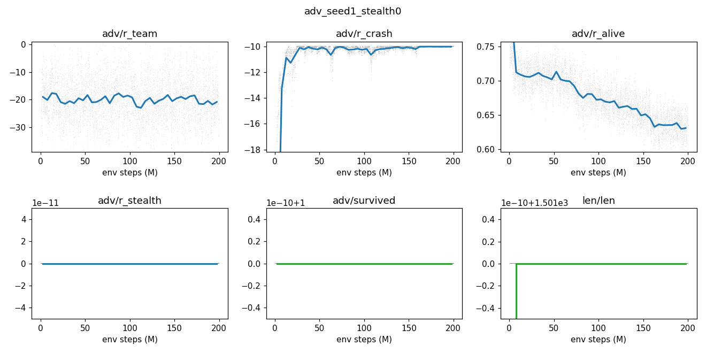
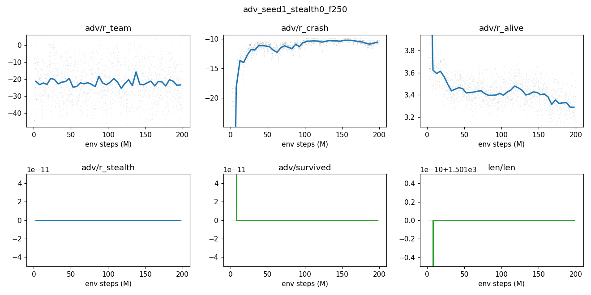
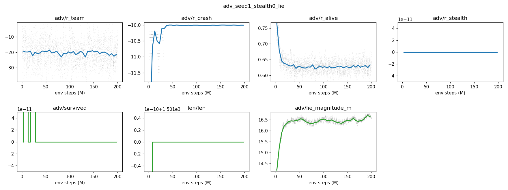
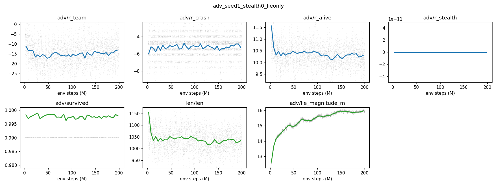
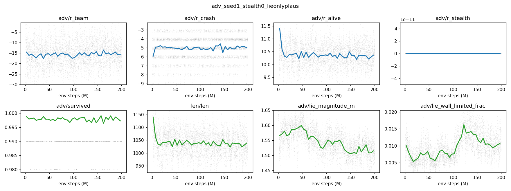
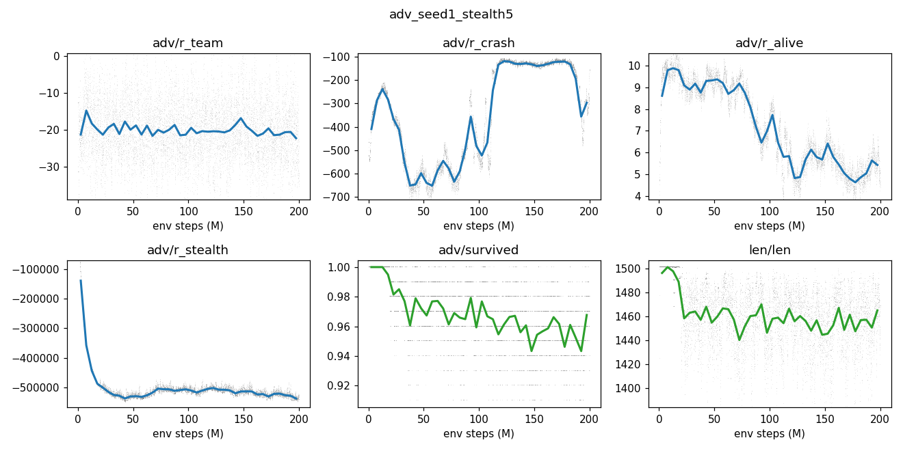
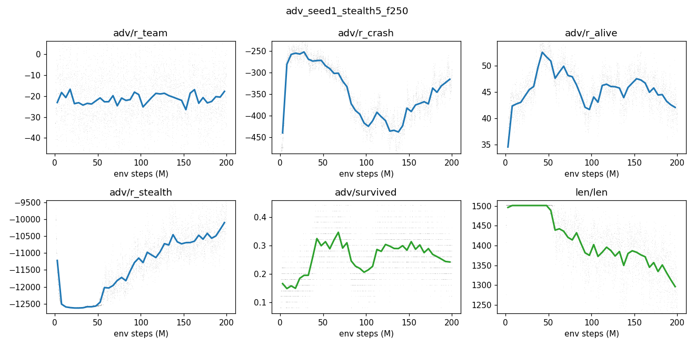
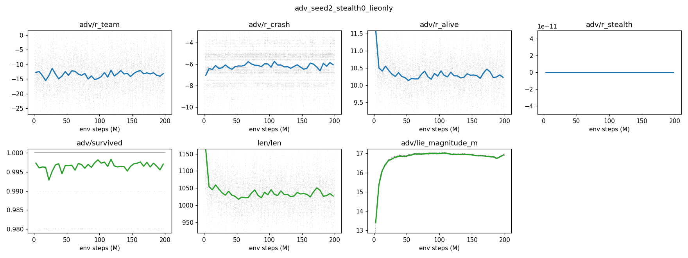
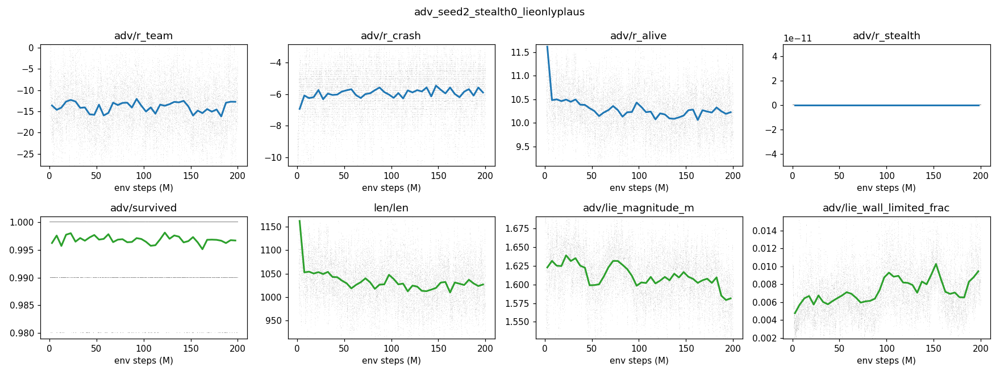
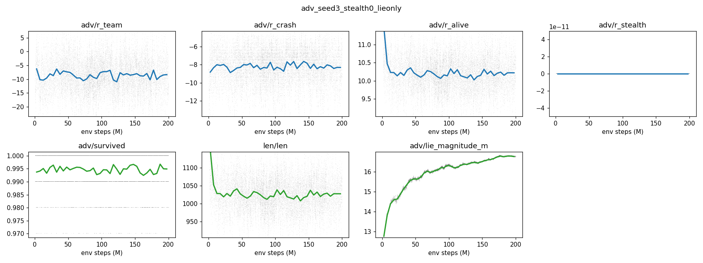
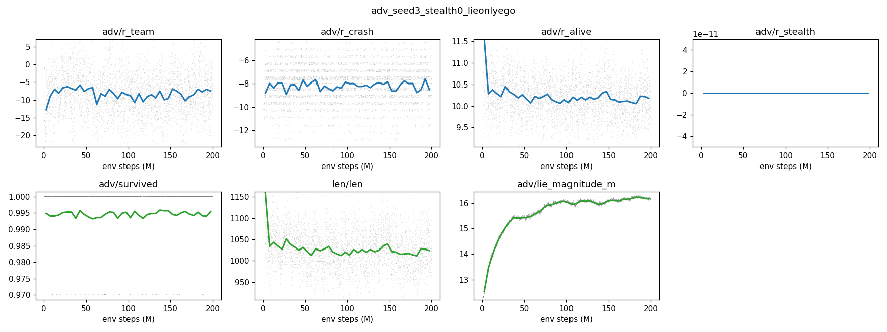
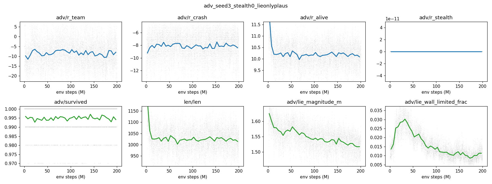
