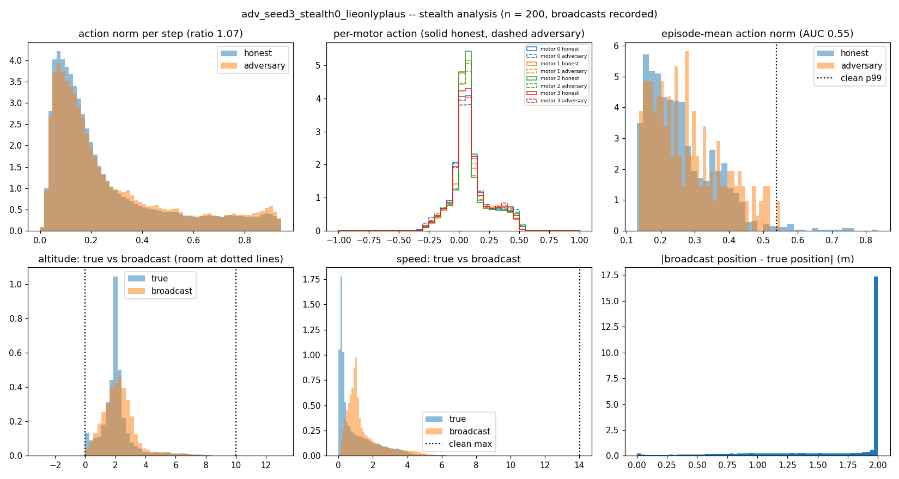

# Stealth analysis -- `adv_seed3_stealth0_lieonlyplaus` (spec item 6)

Own-seed confirmatory run, n = 200 episodes, paired clean run at seed 3. Broadcasts **recorded**. Thresholds set on the clean run only.

## Action level

| statistic | value |
|---|---|
| action-norm ratio adversary / honest | 1.071 |
| AUC, episode-mean action norm, adversary vs honest | 0.554 |
| control: same slot in the CLEAN run -- ratio / AUC | 0.986 / 0.489 |
| naive action detector (> clean p99 = 0.538): adversary episodes flagged | 1.0 % |
| same detector, honest drones flagged | 1.7 % |

## Broadcast physics (naive plausibility checks)

Thresholds (max over every honest drone-step of the clean run): speed 14.01 m/s, acceleration 1444.3 m/s², kinematic residual 0.1158 m; bounds = the 10 x 10 x 10 m room.

| check | adversary steps failing | adversary episodes flagged | honest episodes flagged |
|---|---|---|---|
| bounds | 0.0 % | 0.0 % | 0.0 % |
| speed | 0.0 % | 0.0 % | 0.0 % |
| consistency | 0.0 % | 0.0 % | 0.4 % |
| accel | 0.0 % | 0.5 % | 0.1 % |
| **any check** | | **0.5 %** | 0.4 % |

Broadcast below the floor: 0.0 % of steps. Broadcast speed mean 1.51 m/s (true 1.10). Offset |claim − truth| mean 1.65 m, p99 2.00 m.

**Reading.** An action-level detector sees this adversary iff the AUC is well away from 0.5 *and* from the same-slot clean control. A broadcast check catches it iff "any check" flags its episodes at a rate well above the honest false-alarm rate. The spec asks to say so plainly if a naive detector catches the stealthy adversary.

