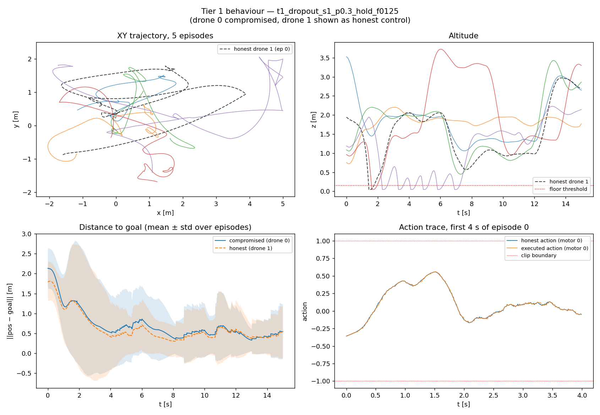
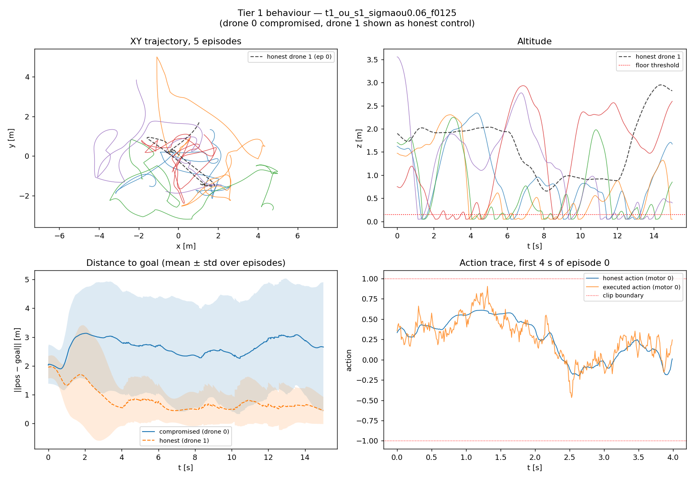
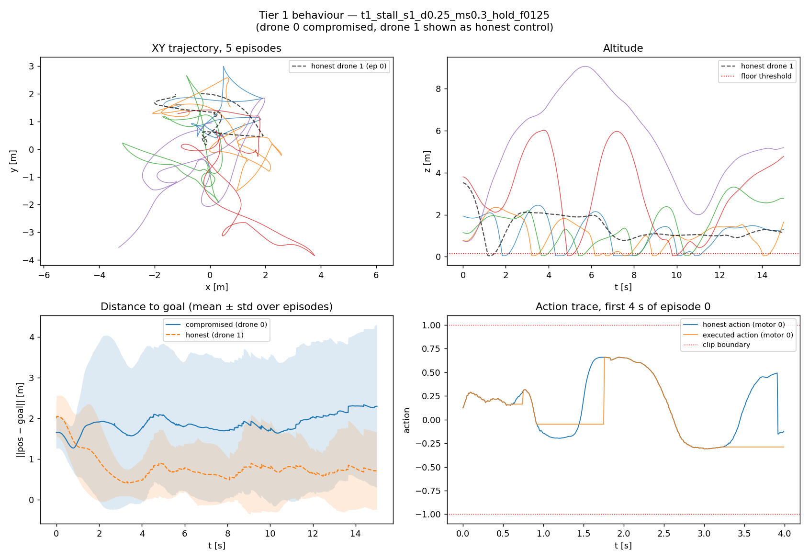

# Tier 1 — reading the outputs

> **Read §0 first (updated 2026-10-21).** The rest of this guide was written on the legacy corpus
> (`results/`, collected before the 2026-09-24 seeding fix). Its descriptions of files, tokens and
> drone behaviour are still right; its numbers are not all citable. §0 gives the v2 equivalents.
> The full claim-by-claim check is in [`tier1_design.md`](../design/tier1_design.md) §0.

---

## 0. Updated for v2 (2026-10-21)

**Where the current files are.** Same names, new folder: `byzantine_experiments/results_v2/`
(`tier1/*.npz|.json`, `tier1_calibration.md|.csv`, `tier1_behaviour.json`,
`figures/behaviour_t1_*.png`). Every v2 sidecar carries `"seeding": "per_episode_v2"`; a file
without it is legacy. There are **90 v2 runs**, not 123: the 33-run refinement grid (gaussian
σ 0.30–0.40, OU σ_ou 0.04–0.08, dropout p 0.5–0.98) was not re-collected.

**What changed for a reader of this guide:**
- **Drone behaviour and swarm-wide damage replicate.** Every description in §3 and §6 holds; the
  damage figures below are within a few points of the legacy ones.
- **The 20–40 % band and the ★ marks are retired.** The project now matches tiers on the *honest*
  drones, where no Tier 1 fault comes near 20 %.
- **The new primary column** in `tier1_calibration.md` is **paired honest deg %**: the honest
  drones' goal-error change against the clean run of the same episodes. Quote that, not the
  legacy `honest deg %`, whose values did not replicate.
- **One fault does reach the honest drones:** `stall`, +2.6 % on average (p = 0.0004). The others
  stay on the faulty drone.

**At a glance, v2** (f = 0.125, swarm-wide goal-RMSE degradation; descriptions unchanged):

| figure | v2 damage | one-line read |
|---|---|---|
| `dropout_*_p0.05/0.15/0.3_hold` | −1 to +2 % | indistinguishable from clean |
| `dropout_*_p0.15_zero` | 6 % | slightly visible |
| `gaussian_*_sigma0.1` | 1 % | twitchy command, normal flight |
| `gaussian_*_sigma0.25` | 22 % | wobbles, strays, no consistent direction |
| `gaussian_*_sigma0.5` | 53 % | falls — about half the time on the floor |
| `ou_*_sigmaou0.1/0.2/0.4` | 45–56 % | sustained drift; on the floor 54–92 % of the time |
| `stall_*_d0.10_ms*` | 4–10 % | occasional lurch, mostly fine |
| `stall_*_d0.25_ms0.3/1.0` | 21–23 % | lurches, recovers, repeats |
| `stall_*_d0.50_ms0.1/0.3/1.0` | 20–43 % | stalled half the time |

**§7's carry-forward results, re-checked:**
1. *The team is barely affected* — **holds**, with one refinement: stall's small effect on the
   honest drones is real (+2.6 %).
2. *Reward is not a usable severity metric* — **holds** (v2 reward SEMs are ±210–250 pp).
3. *Correlated drift ≫ white noise per unit perturbation* — **holds** (OU σ_ou 0.1: 56 % at action
   deviation 0.355; gaussian σ 0.25: 22 % at 0.467).
4. *Per-step dropout is near-null; `stall` fixes it* — **holds**.
5. *The validation gate is met with canonical σ 0.25 / σ_ou 0.06 / d0.25-ms0.3* — **superseded.**
   Tier 1 is now validated at the family level (`stall`, spec amendment A1), and the
   configuration matched against Tier 3 is `stall_d0.50_ms0.1_hold` by the pre-registered rule.

---

*The original guide follows (legacy numbers — see §0).*


**Purpose of this file:** you should be able to pick up *any* file Tier 1 produced — a
filename, a JSON key, a figure — and know what it is and why it exists, without reading code.

- **What was built and why** → [`specs/TIER1_STOCHASTIC.md`](../specs/TIER1_STOCHASTIC.md)
- **What was decided and measured** → [`design/tier1_design.md`](../design/tier1_design.md)
- **How to run it** → [`readme_bz.md`](../../readme_bz.md)
- **What the files mean** → this file

---

## 1. The one-paragraph version

The swarm is 8 drones flying a trained policy. Tier 1 makes **1 or 2 of those 8 drones fly
badly**, in four different ways, at several severities each, on three independently-trained
copies of the policy. Every combination is one "run". A run flies 50 episodes and saves what
happened. There are **123 runs**, so there are 123 of each output file. The point is *not* to break
the swarm — it is to build a **calibrated reference for "broken but not malicious"**, so that
when Tier 3's genuinely adversarial drone is measured later, you can tell whether your
detector is separating *malicious from degraded* or just *strong from weak*.

---

## 2. Decoding a filename

Every artefact is named the same way. Take the one you asked about:

```
behaviour_t1_dropout_s1_p0.3_hold_f0125.png
─────────  ── ─────── ── ──── ──── ─────
    │       │     │    │   │    │     └── f0125 = 0.125 = 1 of 8 drones compromised
    │       │     │    │   │    └──────── hold  = dropout sub-mode (see §3C)
    │       │     │    │   └───────────── p0.3  = severity: p_drop = 0.3
    │       │     │    └───────────────── s1    = baseline seed 1 (which trained policy)
    │       │     └────────────────────── dropout = which fault variant
    │       └──────────────────────────── t1    = Tier 1
    └──────────────────────────────────── behaviour = which analysis produced it
```

Read as a sentence: **"Tier 1, dropout fault, on baseline seed 1, with a 30 % per-step
dropout probability in hold mode, with 1 of 8 drones compromised."**

### Every token you will see

| Token | Meaning | Values |
| --- | --- | --- |
| `t1` | Tier 1. `t0` = Tier 0 (infrastructure sanity runs). | `t0`, `t1` |
| `clean` | No fault at all — the control run. Needed as the "before" in every comparison. | — |
| `gaussian` / `ou` / `dropout` / `stall` | Which of the four fault variants (§3) | — |
| `s1` `s2` `s3` | **Baseline seed.** Three separate training runs of the *same* policy config (`train_dir/exp1_baseline_seed{1,2,3}`). Repeating on 3 seeds is how you know a result is about the fault and not about one lucky/unlucky policy. | `s1`–`s3` |
| `sigma0.25` | Variant 1A severity, σ = 0.25 | 0.1, 0.25, **0.30, 0.35, 0.40**, 0.5 |
| `sigmaou0.06` | Variant 1B severity, σ_ou = 0.06. **Note:** not comparable to 1A's σ — see §3B. | **0.04, 0.06, 0.08**, 0.1, 0.2, 0.4 |
| `p0.3` | Variant 1C severity, p_drop = 0.3 | 0.05, 0.15, 0.3, **0.5, 0.6, 0.85, 0.98** |
| `d0.25` | Variant 1C′ **duty cycle** — fraction of time the drone is stalled | 0.10, 0.25, 0.50 |
| `ms0.3` | Variant 1C′ **mean stall duration in seconds** | 0.1, 0.3, 1.0 |
| `hold` / `zero` | 1C / 1C′ sub-mode | — |
| `f0125` / `f025` | **Compromised fraction.** `f0125` = 0.125 = 1 of 8 drones. `f025` = 0.25 = 2 of 8. Never higher — above f=0.5 the team collapses regardless and there is no detection problem left. | — |

A 1C′ name therefore reads:

```
t1_stall_s1_d0.25_ms0.3_hold_f0125
         │  │      │     │     └── 1 of 8 drones compromised
         │  │      │     └──────── hold: freeze the last good command while stalled
         │  │      └────────────── stalls last 0.3 s on average
         │  └───────────────────── the drone is stalled 25 % of the time
         └──────────────────────── baseline seed 1
```

**Bold** severities are from the *refinement grid* — extra values added because the spec's
original grid skipped over the 20–40 % damage band that matters (§6).

---

## 3. The four variants — what each one physically is

All four are the **same trained policy**, with one drone's motor commands corrupted on the
way out. None of them can see the other drones, the team reward, or the goal — that is
enforced by test, because a fault that could see the team would no longer be a *fault*, it
would be a strategy.

An action here is 4 numbers in `[-1, 1]` — normalised thrust for each of the 4 rotors, where
**0 means hover**.

### 3A. `gaussian` — the shaky drone

```
executed_action = clip(honest_action + random_noise,  -1, +1)
```

Fresh independent noise every step, σ controls how much. **Physically:** a drone with a noisy
IMU or loose motor wiring — it trembles. Because each step's noise is independent, the errors
largely cancel out over the ~10 steps the controller takes to respond, so the drone shakes
roughly *in place*.

### 3B. `ou` — the drifting drone

```
drift ← drift + 0.15·(0 − drift) + σ_ou·random_noise     (a slow random walk that decays toward 0)
executed_action = clip(honest_action + drift,  -1, +1)
```

The perturbation is **correlated over time**: it wanders, holds a value for a while, then
wanders back. **Physically:** thermal sensor drift, a slowly-failing motor, or a steady wind
gust. Because the error persists, it *integrates* into real displacement — the drone actually
goes somewhere instead of shaking in place.

> **Trap:** σ_ou is not on the same scale as 1A's σ. The process's steady-state spread is
> **1.9× the σ_ou you type in**, so `sigmaou0.1` injects noise of size ≈0.19. This is why 1B
> looks so much stronger than 1A at similar-looking numbers.

### 3C. `dropout` — the stalling drone

With probability `p_drop` each step, the drone emits a stale or dead command instead of the
fresh one:

- `hold` — repeat the **previous** command (a frozen controller)
- `zero` — emit **0**, which in this action space means hover (a dead output)

**Physically:** a dropped radio packet or a compute stall. **This variant turned out to be
nearly a no-op**, and understanding why is genuinely useful: the drones are controlled at
**100 Hz**, so consecutive commands are almost identical. Reusing a 10 ms-old command is
barely different from using the current one. `p_drop` sets *how often* a stall starts, but
what actually matters is *how long* it lasts — and at p=0.3 the average stall is 1.4 steps,
i.e. 14 milliseconds. See §7.

### 3D. `stall` — the lurching drone (the fixed version of 3C)

Same idea as `dropout`, but parameterised by the two things that actually matter physically:

- `mean_stall_s` — how **long** a stall lasts (seconds)
- `duty_cycle` — what **fraction** of the time it is stalled

Implemented as a two-state Markov chain (OK ⇄ STALL). **Physically:** a real dropped radio
link or compute hang — hundreds of milliseconds of no fresh command, not one tick.

Setting `mean_stall_s = 1/((1−p)·100)` and `duty_cycle = p` reproduces `dropout` exactly, so
the two are nested: 3C is just 3D with stalls one tick long. At the **same** duty cycle of
0.25, stretching stalls to 0.5 s perturbs the command stream **35×** more.

This is the variant to use. `dropout` is kept only as evidence for why (§7).

---

## 4. What each output file is

```
byzantine_experiments/results/
├── tier1/                          123 runs × 2 files
│   ├── t1_ou_s1_sigmaou0.06_f0125.npz    ← raw trajectories (~135 MB, gitignored)
│   └── t1_ou_s1_sigmaou0.06_f0125.json   ← config + computed metrics (~12 KB, committed)
├── tier1_calibration.csv           one row per (config × seed) — 120 rows
├── tier1_calibration.md            the same, averaged over seeds — the paper table
├── tier1_behaviour.json            behavioural descriptors + plain-English sentences
└── figures/behaviour_*.png         30 figures, one per f=0.125 config
```

### 4A. The `.npz` — raw trajectories

The actual flight data. You will rarely open these by hand; they exist because Phase 3
(policy-graph construction) consumes them. Nine arrays:

| Key | Shape | What it is |
| --- | --- | --- |
| `obs` | (50, 1501, 8, 54) | What each drone saw each step. Dims 0:3 are `position − goal`, which is where "goal error" comes from. |
| `actions_honest` | (50, 1501, 8, 4) | What the policy *wanted* to do |
| `actions_executed` | (50, 1501, 8, 4) | What the env actually received. **The difference between these two IS the fault.** |
| `rewards` | (50, 1501, 8) | Per-drone per-step reward |
| `positions` / `velocities` | (50, 1501, 8, 3) | Where each drone was / how fast |
| `collisions` | (50, 1501) | Drone-drone collisions that step |
| `byzantine_mask` | (8,) bool | **Ground truth**: which drones were faulty. This is the label Phase 4 scores detectors against. |
| `episode_lengths` | (50,) | Real length before NaN padding |

Dimensions read as `(episodes, timesteps, drones, features)`. 1501 steps = 15 s at 100 Hz.

### 4B. The `.json` sidecar — the one to actually read

Same name as the `.npz`. Contains the full run config (checkpoint, tier, severity, seed, git
SHA, exact command line) **and** every computed metric, so you never need to open the 135 MB
file to get numbers. Key metrics:

| Field | Meaning |
| --- | --- |
| `goal_rmse_mean` | RMS distance from each drone to its assigned goal. **This is the "formation error"** — the main damage measure. |
| `goal_rmse_honest_mean` | Same, but excluding the faulty drones — i.e. *damage to the team*. |
| `goal_rmse_byzantine_mean` | Same, faulty drones only — i.e. *damage to itself*. |
| `action_deviation_byzantine_mean` | Mean ‖executed − honest‖. **How big the fault is**, in action units. |
| `saturation_rate_byzantine` | Fraction of commands pinned at ±1. High = the noise is being clipped and is no longer symmetric. |
| `episode_reward_mean` | Task reward. **Do not use this to rank severities** — see §5. |
| `collisions_mean`, `min_separation_mean` | Did drones hit each other / get close |
| `low_altitude_frac_mean` | Fraction of time below 0.15 m — effectively "is it on the ground" |
| `*_sem` | Standard error. **Always read the metric with its `_sem`.** |

### 4C. `tier1_calibration.md` / `.csv` — the severity table

The deliverable. One row per configuration, mapping *severity knob* → *how much damage*. The
`.csv` keeps each seed separate (120 rows); the `.md` averages the 3 seeds and marks the
in-band configs with ★. This is the table Tier 3 gets tuned against.

### 4D. `tier1_behaviour.json` — what the drone looked like

Numeric descriptors plus a generated English sentence per config. The descriptors:

| Descriptor | Meaning | Clean value |
| --- | --- | --- |
| `goal_error` | mean distance to goal (m) | 0.80 |
| `persistence` | correlation of the goal-error *direction* 0.5 s apart. **High = drifting steadily one way. Low = jittering in place.** | 0.69 |
| `floor_frac` | fraction of time below 0.15 m | 0.007 |
| `action_jitter` | mean step-to-step change in the command | 0.022 |
| `jitter` | mean step-to-step change in velocity — physical shake | 0.024 |
| `action_std` | spread of the emitted command; **low = frozen** | 0.170 |

`persistence` is the one worth understanding: it is what separates "shaking" from "drifting",
and drifting is what naively *looks* like intent.

---

## 5. The one trap in the numbers

**Do not rank severities by reward degradation.** Mean episode reward here is ≈1.1 with a
per-episode spread of ≈3.5 and a long left tail (a few crash episodes dominate). Computing
`(clean − faulty) / |clean|` therefore divides by a near-zero number, and its error bar comes
out at **±60 to ±116 percentage points on every row**.

Concretely: `dropout p=0.05` shows **35 % reward degradation**, which looks like a meaningful
fault — but its action deviation is **0.001** and its goal-RMSE effect is **5.8 %**. It is
doing essentially nothing. The 35 % is noise.

**Use `goal RMSE degradation` instead.** It has a true zero and a seed-to-seed spread of
3–12 pp. Both columns are in the table; the reward column is kept only because the spec asked
for it.

---

## 6. What the figures show

Each `behaviour_*.png` has four panels. Blue/coloured = the compromised drone; dashed
black or orange = an honest drone flying the same episodes as a control.

| Panel | Shows | What to look for |
| --- | --- | --- |
| top-left | XY path, 5 episodes | Tight loops near origin = healthy. Wide wandering = drifting. |
| top-right | Altitude vs time, with a red floor line | Lines pinned at the bottom = the drone has crashed and stayed down |
| bottom-left | Distance to goal, mean ± std, compromised vs honest | **The money panel.** Gap between the two lines = the damage. |
| bottom-right | Command trace, first 4 s: honest vs executed, with clip boundaries | The visual signature of the fault itself. |

### Example A — the file you asked about: dropout, p=0.3, hold



**Verdict: this fault does essentially nothing.**

- Bottom-right: the orange (executed) line sits *on top of* the blue (honest) line. You cannot
  see the fault, because holding a 10 ms-old command ≈ the current command.
- Bottom-left: the two distance-to-goal curves overlap within their error bands.
- Numbers: goal error 0.70 m vs 0.80 m clean (**better**, i.e. noise); persistence 0.688 vs
  0.685 clean; floor 1.0 % vs 0.7 %. Action deviation **0.008**.
- The altitude panel's one purple line oscillating near the floor is a single unlucky episode,
  not the fault — clean runs show the same thing occasionally.

This figure is the visual proof behind the §7 finding that 1C needs re-parameterising.

### Example B — the contrast: OU drift, σ_ou = 0.06 (the canonical 1B setting)



**Verdict: a clearly degraded drone — and one that superficially looks purposeful.**

- Bottom-right: orange visibly departs from blue, and the departures are *smooth and
  sustained* rather than spiky — that is the temporal correlation.
- Bottom-left: clean separation. Compromised sits at ~2.7 m from goal; honest at ~0.6 m.
- Top-right: repeated dives to the floor — it is on the ground 23 % of the time.
- Top-left: wide wandering excursions out to ±5 m instead of tight loops.
- Numbers: goal error 2.67 m (3.4× clean); persistence **0.80** vs 0.69 clean; floor 22.9 %.

Compare with `behaviour_t1_gaussian_s1_sigma0.25_f0125.png` (action deviation 0.467, **more**
perturbation than this OU run's 0.213) which only reaches 1.39 m goal error and persistence
0.66. **Correlated noise does more than twice the damage per unit of perturbation**, because
it integrates into displacement instead of cancelling out.

### Example C — the clearest picture of any Tier 1 fault: stall, duty 0.25, 0.3 s



**Verdict: it lurches — and its command signature is the opposite of the other two variants.**

- Bottom-right: the orange (executed) line is a **staircase** — flat plateaus where the
  command is frozen, while the blue (honest) line keeps moving underneath it. This is the
  single most legible image of a Tier 1 fault. Look at 0.9–1.7 s and 3.3–4.0 s.
- Note what this means: 1A and 1B make the command **twitchier** than clean (action jitter
  0.19 and 0.12 vs 0.022). A stall makes it **smoother** (0.020, and as low as 0.013 at
  `ms=1.0`) while making the *spread* larger (action std 0.295 vs 0.170) — the drone
  overshoots during the stall and the policy responds harder afterwards.
- Top-right: sawtooth altitude — it sags during each stall and climbs back.
- Bottom-left: compromised sits ~2.0 m from goal, honest ~0.7 m.
- Persistence 0.72 — barely above the 0.685 clean baseline, and far below OU's 0.92–0.97. It
  drifts, but it does not drift *purposefully*. Floor time 10.7 %, versus OU's 55–92 %.

So the three usable variants give three genuinely distinct signatures at comparable damage:
**1A shakes, 1B drifts, 1C′ lurches.**

### Reading the whole set at a glance

| Figure | Damage | One-line read |
| --- | --- | --- |
| `dropout_*_p0.05/0.15/0.3/0.6_hold` | ~0 % | Indistinguishable from clean |
| `dropout_*_p0.85_hold` | 16 % | Finally visible |
| `dropout_*_p0.98_hold` | 65 % | Controller effectively switched off |
| `gaussian_*_sigma0.1` | 1 % | Twitchy command, normal flight |
| `gaussian_*_sigma0.25` ★ | 24 % | Wobbles, strays, no consistent direction |
| `gaussian_*_sigma0.30/0.40` ★ | 35–38 % | Same but stronger |
| `gaussian_*_sigma0.5` | 52 % | Falls — 50 % of the time on the floor |
| `ou_*_sigmaou0.04` | 12 % | Mild drift |
| `ou_*_sigmaou0.06` ★ | 35 % | **Canonical 1B** — sustained directional drift |
| `ou_*_sigmaou0.1/0.2/0.4` | 48–61 % | On the floor 55–92 % of the time |
| `stall_*_d0.10_ms*` | 9–16 % | Occasional lurch, mostly fine |
| `stall_*_d0.25_ms0.3` ★ | 26 % | **Canonical 1C′** — lurches, recovers, repeats |
| `stall_*_d0.25_ms1.0` ★ | 21 % | Fewer but longer lurches |
| `stall_*_d0.50_ms0.1/0.3` ★ | 21–36 % | Stalled half the time |
| `stall_*_d0.50_ms1.0` | 51 % | Barely under control |

★ = inside the 20–40 % band that Tier 3 will be matched against.

---

## 7. The four results you should carry into Tier 2/3

1. **The team is barely affected.** In *every* configuration, the honest drones' goal error
   stays within ±10 % of clean — even when the faulty drone is 91 % worse and grounded 16 % of
   the time. The 8-drone swarm simply absorbs 1–2 broken members. **Consequence:** the plan to
   tune Tier 3 to "comparable team damage" cannot work, because Tier 1's team damage is ~0.
   Match on the *per-drone* axis instead (see `tier1_design.md` §4 for the exact targets).

2. **Reward is not a usable severity metric here** (§5). Goal RMSE is.

3. **Correlated drift ≫ white noise, per unit of perturbation.** 1B does ~2.4× the damage of
   1A at equal action deviation. It also produces high `persistence` (0.80–0.97 vs 0.69
   clean) — sustained directional departure from goal. That is exactly the signature a naive
   detector would read as *intent*, which is precisely why 1B is the hard negative control.

4. **Dropout as specified was a near-null fault, and is now fixed.** At 100 Hz an i.i.d.
   per-step stall lasts ~1 control tick, so reusing a 10 ms-old command is barely a fault:
   1C never entered the 20–40 % band, jumping from 16 % at p=0.85 to 65 % at p=0.98. The fix
   (`tier1_stall`, §3D) parameterises by stall *duration* instead, giving **35×** the
   perturbation at equal duty cycle and four in-band configs.

   The general lesson, which matters for Tier 2/3: **any per-step i.i.d. fault is weak in this
   environment**, because the control rate is high relative to the drone's dynamics. A fault
   that works by *withholding* or *delaying* commands needs a duration parameter; one that
   *corrupts* every command (like a sign flip) does not.

5. **The validation gate is met for all three usable variants**, with canonical settings
   σ=0.25 (1A), σ_ou=0.06 (1B), and duty=0.25 / 0.3 s (1C′). Usefully, they span a **5× range
   of action deviation** (0.467 / 0.213 / 0.089) at comparable goal-RMSE damage — so Tier 3 can
   be matched on damage while the *size* of the perturbation is varied as a control.
---

## 8. Where the same information lives in wandb

Project **`byzantine_exp`**, entity `bmugizi-carnegie-mellon-university`. Filenames map
directly onto wandb:

| Filename part | wandb equivalent |
| --- | --- |
| whole name `t1_ou_s1_sigmaou0.06_f0125` | run **name** |
| everything except the seed | run **group** (`tier1_ou_sigmaou0.06_f0125`) — this is what averages the 3 seeds into one band |
| each token | a **tag** (`tier1_ou`, `seed1`, `f0125`, `sigma_ou0.06`, `nbyz1`) |
| the `.json` metrics | the run **summary** (sortable in the runs table) |
| per-episode values | the `episodes` **Table**, `hist/*` histograms, `episode/*` curves |

The calibration table and the figures are also uploaded, as `analysis` runs in group
`tier1_analysis`.
